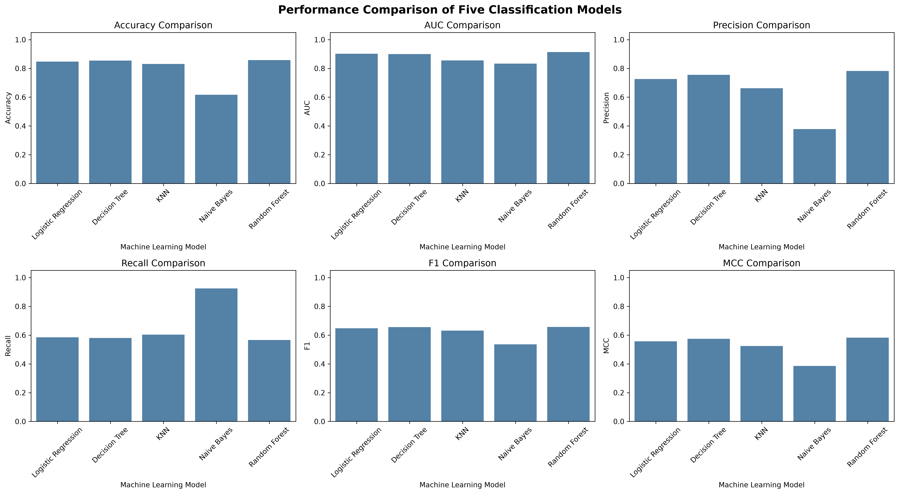

# Adult Income Classification - Machine Learning Assignment 2

## 1. Problem Statement

The objective of this project is to predict whether an
individual earns more than $50,000 annually using
demographic and employment-related information.

Five machine learning classification models are implemented
and compared using six evaluation metrics.

## 2. Dataset Description

Dataset: Adult Income Dataset

Source: UCI Machine Learning Repository
https://archive.ics.uci.edu/dataset/2/adult

Original Records: 48,842
Input Features: 14
Target Variable: income

Classification Type: Binary Classification

Target Classes:
- <=50K
- >50K

Records After Duplicate Removal: 48,790

Training Records: 39,032
Testing Records: 9,758

Missing Values After Duplicate Removal: 6,456

## 3. GitHub Repository Link

GitHub Repository: https://github.com/2026ct05180-sys/Adult-Income-ML-Classification

## 4. Data Preprocessing

1. Identified missing values represented by '?'.
2. Removed 52 duplicate records.
3. Converted '?' into NaN.
4. Examined class distribution.
5. Performed an 80:20 train-test split.
6. Used stratified splitting.
7. Used random_state=42.
8. Applied median imputation for numerical features.
9. Applied most-frequent imputation for categorical features.
10. Applied One-Hot Encoding.
11. Applied StandardScaler.
12. Fitted preprocessing only on training data.

## 5. Models Used

### Logistic Regression
- max_iter=1000
- random_state=42

### Decision Tree
- max_depth=10
- min_samples_split=10
- random_state=42

### K-Nearest Neighbors
- n_neighbors=5
- weights=uniform

### Gaussian Naive Bayes
- GaussianNB with default parameters

### Random Forest
- n_estimators=100
- max_depth=15
- min_samples_split=5
- random_state=42

## 6. Model Comparison Results

| ML Model Name       |   Accuracy |    AUC |   Precision |   Recall |     F1 |    MCC |
|:--------------------|-----------:|-------:|------------:|---------:|-------:|-------:|
| Logistic Regression |     0.8477 | 0.902  |      0.7258 |   0.5848 | 0.6477 | 0.5572 |
| Decision Tree       |     0.8545 | 0.9001 |      0.7553 |   0.5801 | 0.6562 | 0.5738 |
| KNN                 |     0.8315 | 0.8558 |      0.6624 |   0.604  | 0.6319 | 0.5239 |
| Naive Bayes         |     0.6173 | 0.8329 |      0.3777 |   0.9242 | 0.5363 | 0.3855 |
| Random Forest       |     0.8583 | 0.9139 |      0.7818 |   0.5659 | 0.6566 | 0.582  |

## 7. Performance Visualization

The following six evaluation metrics were visualized:
Accuracy, AUC, Precision, Recall, F1 Score, and MCC.

## 8. Model Performance Observations

| ML Model Name       | Observation about Model Performance                                                                                                                                                                     |
|:--------------------|:--------------------------------------------------------------------------------------------------------------------------------------------------------------------------------------------------------|
| Logistic Regression | Achieved 84.77% accuracy and 0.9020 AUC. Provides good overall classification performance, but recall is relatively moderate.                                                                           |
| Decision Tree       | Achieved 85.45% accuracy with an F1 score of 0.6562. Performed slightly better than Logistic Regression in accuracy, precision, F1, and MCC.                                                            |
| KNN                 | Achieved 83.15% accuracy and 0.6040 recall. Identified more high-income individuals than Logistic Regression and Decision Tree, but with lower precision.                                               |
| Naive Bayes         | Achieved the highest recall of 0.9242, but the lowest accuracy of 61.73%. Its low precision indicates many false positives.                                                                             |
| Random Forest       | Achieved the highest accuracy of 85.83%, AUC of 0.9139, precision of 0.7818, and MCC of 0.5820. It provides strong overall performance.                                                                 |
| Overall Winner      | Random Forest is selected as the overall winner because it achieved the highest accuracy, AUC, precision, and MCC, with a competitive F1 score. However, its recall is lower than that of other models. |

## 9. Overall Winner

Random Forest achieved the highest accuracy, AUC,
precision, and MCC among the five models.

Therefore, Random Forest was selected as the
overall best-performing model for this dataset.

Naive Bayes achieved the highest recall but had
lower accuracy and precision.

## 10. Execution Instructions

1. Download or clone the GitHub repository.
2. Install Python and Jupyter Notebook.
3. Install the libraries in requirements.txt.
4. Open the notebook ML_Assignment Sanjay.ipynb.
5. Ensure adult.csv is in the project folder.
6. Run all notebook cells sequentially.
7. Review the model results and comparison graphs.

## 11. Project Files

- adult.csv
- ML_Assignment Sanjay.ipynb
- requirements.txt
- README.md
- test_data.csv
- model_comparison_results.csv
- model_observations.csv
- model_comparison_graph.png
- model/

## 12. Conclusion

Five machine learning classification algorithms
were implemented using the Adult Income Dataset.

Random Forest achieved the strongest overall performance,
while Naive Bayes achieved the highest recall.

The results demonstrate the importance of comparing
multiple evaluation metrics when selecting a model.
